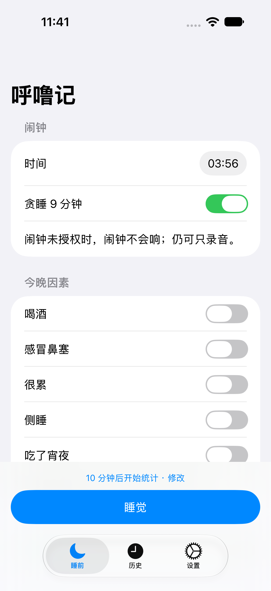
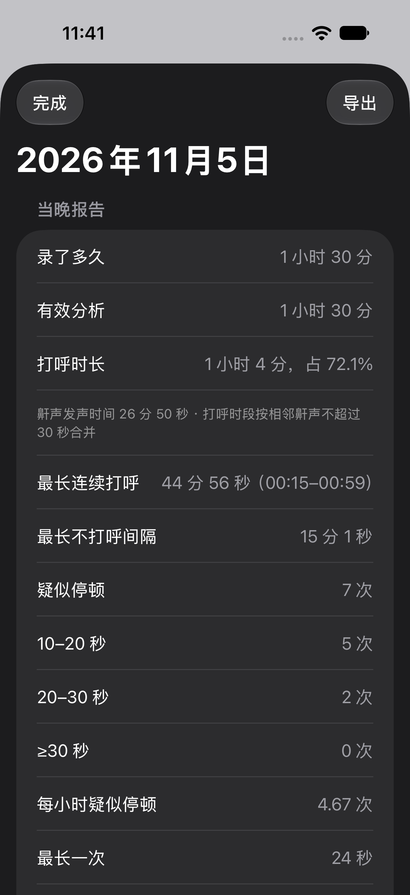
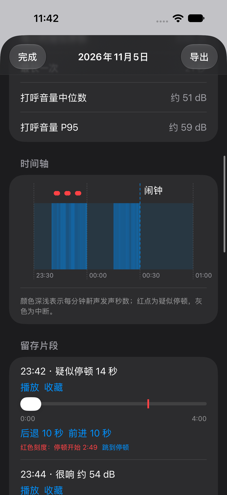
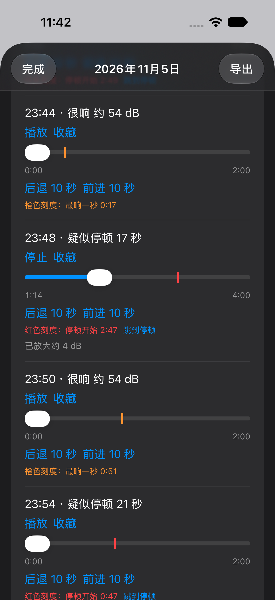

# 呼噜记 · 整夜打呼记录（iOS）

睡前设个闹钟、点「睡觉」、锁屏放床头，早上长按「起床」，就能看到这一晚：

- 录了多久、**打呼了多久、占整晚多少**
- 最长连续打呼多久、最长多久没打呼
- **疑似呼吸停顿**几次、最长停了多久（打呼中突然安静 10 秒以上，再「憋醒」似的大喘一声）
- 打呼音量（约 dB）、整夜时间轴
- 自动留下最值得听的 ≤12 段录音（停顿前后、最响的、最长那段），可拖进度条、一键「跳到停顿」

全部在手机本地完成：**不联网、不上传、没有账号**。整夜录音只在早上分析前临时存在手机里，分析完自动删除。

<p>




</p>

（截图是合成演示数据。）

> ⚠️ **这不是医疗设备，不做任何诊断。** 手机录音会误判（同床的人打呼、电视、风扇都可能干扰）。
> 如果连续多晚都有较多疑似停顿，或白天特别困、早上头痛，请去医院睡眠科做睡眠监测。

## 怎么装到自己的 iPhone

目前没有上架 App Store，需要自己用 Mac 编译安装（免费 Apple ID 就行）：

1. Mac 上从 App Store 装 **Xcode**（27 或更新），第一次打开时同意许可，并在 Settings → Components 装 iOS 平台。
2. Xcode → Settings → Accounts，用你的 Apple ID 登录。
3. 下载本仓库，复制签名配置并填上你自己的：
   ```bash
   cp ios/Config/Local.example.xcconfig ios/Config/Local.xcconfig
   ```
   `DEVELOPMENT_TEAM` 填你的个人团队编号；`BUNDLE_ID_PREFIX` 随便填一个独有的前缀（比如 `com.你的名字`）。
   不知道团队编号的话：用 Xcode 打开 `ios/SnoreLog.xcodeproj`，在 Signing & Capabilities 里选你的 Personal Team 即可。
4. iPhone 用数据线连 Mac，在手机「设置 → 隐私与安全性」打开**开发者模式**（会重启）。
5. Xcode 顶部选你的 iPhone，点运行。第一次打开 App 前，在手机「设置 → 通用 → VPN 与设备管理」里信任你的开发者证书。

**免费 Apple ID 装的 App 每 7 天会过期**，过期后打不开、闹钟也不会响，要连 Mac 再点一次运行（数据不丢）。App 设置页会显示到期时间，到期前一天晚上会提醒。付费开发者账号（688 元/年）装一次管一年。

系统要求：iOS 26 及以上（闹钟用的是 iOS 26 的 AlarmKit）。

## 使用建议

- 手机放床头柜，离头 30–50 厘米，**插着充电**，底部麦克风朝床。
- 点「睡觉」后直接锁屏，**不要从后台划掉 App**。
- 「延迟开始统计」默认 10 分钟，躺下刷手机那段不算。
- 早上关掉闹钟后打开 App，长按「起床」，分析一晚 8 小时录音大约要一两分钟，可以离开 App，回来会接着算。
- 原始录音很小声（为了每晚的音量可比，录音时关闭了自动增益），播放时会自动放大，存档不改。

## 它是怎么判断的

- 打呼识别用苹果系统自带的声音分类器（SoundAnalysis，内置 `snoring` 类），不用自己训练模型。
  **这个分类器在 App 锁屏后台不能用**（实测每次报错），所以夜里只录音、算音量，早上回到前台再统一分析。
- 每秒一帧：音量（约 dB）+ 打呼置信度；噪声底按最近 5 分钟的 10 分位数自适应（开风扇、空调也不会误报）。
- 打呼时长按「打呼时段」算：相邻两声鼾相隔 30 秒以内算同一段。
- 疑似呼吸停顿：正在打呼 → 连续安静 10–90 秒 → 5 秒内出现大喘或重新打呼。只是「不打了」不算。
- 全部阈值和规则写在 [`docs/requirements.md`](docs/requirements.md)（R1–R11），都是产品初值，不是医学标准。

**已知局限**：苹果分类器对远场、轻声的鼾声会漏判一部分；同床有人打呼分不出是谁；规则会把「停止打呼 10 秒后关门」误当成一次停顿（见 `fixtures/` 的 07b 样本）。

## 目录

| 目录 | 内容 |
|---|---|
| `core/` | 分析内核 `SnoreCore`（Swift Package）+ 命令行 `snore-analyze`，能在 Mac 上离线分析整晚录音 |
| `ios/` | iOS App（SwiftUI） |
| `fixtures/` | 验收样本：合成整晚音频生成器、规则的 Python 参考实现、对照脚本 |
| `docs/` | 需求确认单与每一期的开发交接记录（这个项目是人和 AI 分工完成的：Claude 写需求和验收，Codex 写代码） |

## 开发者

```bash
export DEVELOPER_DIR=/Applications/Xcode.app/Contents/Developer
swift test --package-path core                 # 内核单元测试
python3 fixtures/gen.py                         # 生成合成样本（约 460 MB，只写文件不出声）
python3 fixtures/check.py --codex               # 内核 vs 规则参考实现，含分块一致性
swift test --package-path ios                   # App 管线测试（在 Mac 上跑）
python3 ios/Scripts/check_demo.py               # 演示夜：App 管线与命令行逐字段一致
```

分析一个录音文件：

```bash
swift run -c release --package-path core snore-analyze 某晚.m4a --delay 600
```

## 许可

MIT
